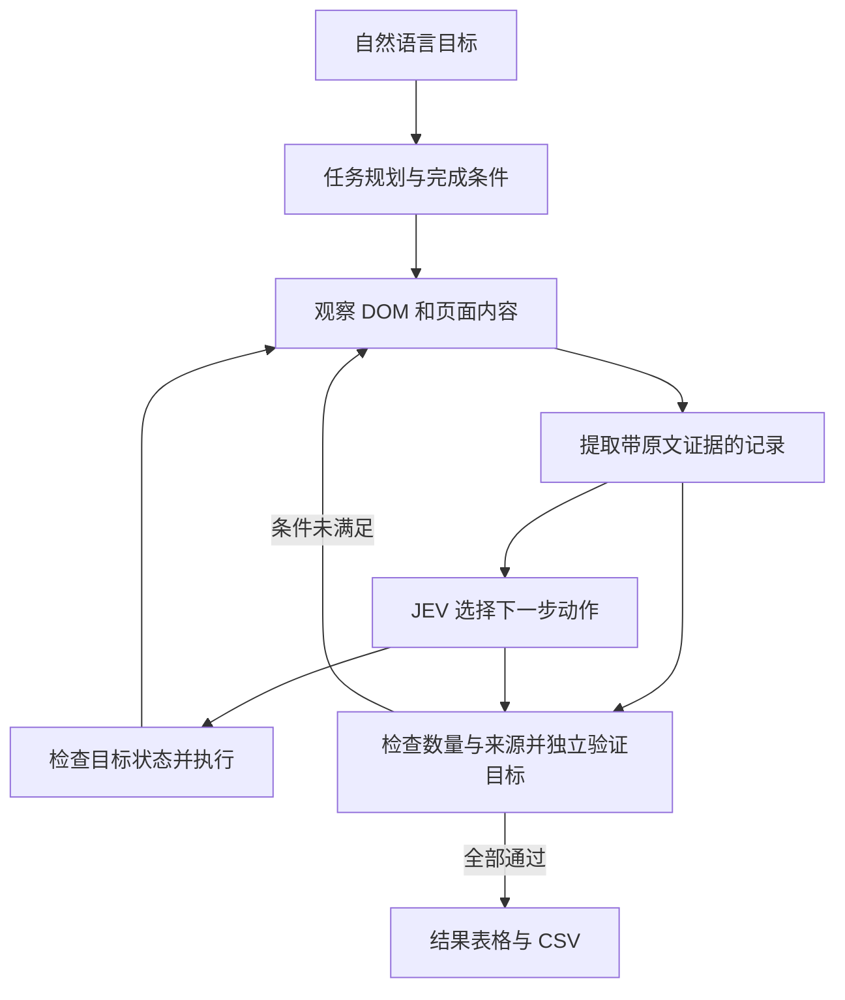

# Jev Chromium

> **基于 TypeSafe Jev 结构化决策模型与 Beautiful UI 现代设计系统的 AI 原生浏览器应用**
> *An AI-native autonomous browser powered by TypeSafe Jev structured decision model and Beautiful UI.*

[](https://www.electronjs.org/)
[](https://nodejs.org/)
[](https://www.beautifului.dev/)
[](https://typesafe.ai)
[](LICENSE)

---

## 核心特性 (Key Features)

### 1. JEV 快速决策与任务验证
- 观察 DOM 可操作元素和页面文字，一次请求并行询问操作及目标，由 Chromium 执行。
- 文本模型负责任务规划、字段填值、信息提取和独立完成验证；不将单步模型耗时视为整个任务耗时。
- 当前未使用截图视觉识别；复杂 iframe、Shadow DOM 和 Canvas 页面尚未完整支持。

### 2. Beautiful UI 现代设计系统 (Modern AI-Native UI)
- **56px 一体化 Prompt Bar**：将自然语言指令输入、标准网址导航与 Agent 控制器无缝融合，极致释放网页可视区域。
- **微交互与呼吸动效**：配备 3x3 像素矩阵呼吸灯（`.pixel-grid`）、运行态旋转渐变圈、完成态弹性对勾，毫秒级高精度思考计时器。
- **任务状态卡片 (Task Rows)**：标准化轻量操作胶囊（`[CLICK]`、`[FILL]`、`[NAVIGATE]`、`[DONE]`），支持点击展开查看模型置信度分布与目标元素属性。

### 3. 原生架构与抽屉中心 (Native Electron Architecture)
- **WebContentsView 硬件加速**：基于 Electron 最新 `WebContentsView` 架构，与 Chromium 渲染引擎直接贴合，支持完整的现代网页功能、弹窗拦截与安全沙箱。
- **抽屉式设置与监控中心**：侧边抽屉无缝整合 `[执行步骤]`、`[运行日志]` 与 `[设置中心]`，彻底规避原生视图图层遮挡问题。

### 4. 动态模型配置与热更新 (Multi-Model Support & Hot-Reload)
- **双引擎协同工作**：
  - **核心动作决策**：TypeSafe Jev (`jev-latest`)，负责点击、聚焦、跳转、完成等动作规划；
  - **内容智能生成**：兼容 OpenAI 规范的辅助大模型（默认预设 **MiniMax**，亦可一键切换为 **DeepSeek**、**OpenAI** 或自定义网关），负责任务规划、填值、跨页面信息提取和完成验证。
- **即时测试与持久化**：界面内支持一键测试 Jev 与文本模型连通性（附带真实延迟反馈），配置热更新并持久化回写至 `.env`。

---

## ️ 运行流程架构 (Architecture)




---

## 当前可用流程

输入自然语言，例如：

> 从 https://example.com/product-a 和 https://example.com/product-b 搜集两个产品的名称、价格和库存，整理成表格，库存缺失标为未找到。

也可以先打开一个产品目录，再输入：

> 跨页面搜集 3 款产品的名称、价格和库存，整理成表格。

网址仅为格式示例，请替换为实际来源。当前需要同时配置 JEV 和文本模型。结果显示在原有右侧步骤抽屉中，支持查看来源、复制 CSV 和导出 CSV；悬停单元格可查看引用原文。

- 暂停/停止会取消模型请求和后续动作；已发给浏览器的操作不能回滚。单步执行一个观察/决策周期。
- `DONE` 只触发验证。搜集数量、来源覆盖和所有完成条件通过后才标为完成；缺失值保留为“未找到”。
- 每个非空单元格必须匹配实际访问页面的原文。记录按来源网址和首列名称合并；不同来源保留不同记录。
- 默认限额：60 个执行周期、12 个访问页面、100 条记录、10 分钟活动时间。暂停不消耗活动时间；恢复不重置已用预算。达到上限保留部分结果。
- 低置信度先检查目标是否已满足；未满足时重新读取页面、采集新增信息并重建操作候选，再判断。每次决策最多判断 3 次，每个任务额外重判最多 12 次，计入原有活动时间，继续任务不会重置预算。保持原有置信度阈值；不执行不确定动作，连续无法确定时才保留结果并暂停。重判期间同样支持暂停/停止，界面沿用现有状态与日志。
- 云端格式错误会在当前模型调用内自动纠正：语法、字段结构、原文依据及验证引用共享最多 4 次请求；输出截断会增加输出额度（上限 12000 tokens）。JEV 无效操作或概率也在原有 4 次请求预算内重试。不会重放浏览器操作、清空表格或重置任务预算；停止/暂停会取消重试。持续无效才保留结果并提示稍后继续。恢复记录保存在任务的 `recoveries` 中，界面沿用现有状态提示和日志。
- 最近一次任务保存到 Electron userData 下的 `tasks/current-task.json`。重启后未完成任务以暂停状态恢复，需要点击继续。新任务替换最近任务记录。
- 登录态保存在本机；任务所需页面文字会发送到配置的云端模型。首版不提供通用多标签调度，也不保证覆盖所有网站。
- 这是带程序证据约束的模型验证，复杂语义仍可能判断错误；“全站全部记录”等穷尽式任务不能靠有限样本宣称完成。

## 验证命令

```bash
npm test                 # 离线单元测试 + 真实 Chromium / 本地页面 / 确定性模型替身
npm run test:live        # 真实 JEV 与文本模型 + 本地两页样例，会调用已配置 API
npm run test:proxy       # 单独检查模型网络连通性
```

浏览器测试使用隔离的临时用户目录，不操作日常登录态；测试输出提供结果 CSV 和界面截图所在目录。`test:live` 验证的是本地样例的真实模型链路，不代表生产网站成功率。

实际界面验收可先运行 `node scripts/manual-test-site.js`，保持服务运行，再在应用中输入：

- `从 http://127.0.0.1:4178/ 开始，分别打开两个产品详情页，搜集名称、价格、库存并整理成表格；库存缺失标为未找到。` 预期两条记录、两个详情页来源，白桦鼠标库存为空，CSV 导出一致。
- `打开 http://127.0.0.1:4178/filter，在页面内筛选南方航空，仅显示南方航空航班。` 预期下拉框选中南方航空且列表仅有 CZ1234。
- 运行中暂停，再继续；暂停时更改目标并单步；停止后重启应用。分别检查无追加动作、按新目标运行、已停止状态保留。

这些页面只提供已知测试数据；界面任务仍调用已配置的真实模型。

真实网站也可直接在应用中输入以下目标，测试从入口发现链接、打开详情、返回入口、采集与验证的完整流程：

- `从 https://www.python.org/downloads/ 列表页出发，自动打开两个不同的 Python 3 正式发行详情页，分别搜集版本名称、发布日期并整理为两行表格，附上实际详情页来源。只从详情页采集，不要采集列表页。`
- `从 https://news.ycombinator.com/ 首页出发，自动打开三个不同新闻的评论详情页，分别搜集新闻标题、提交者、积分，整理成三行表格并附实际来源。只从新闻评论详情页采集，不要从首页列表或用户资料页采集，缺失字段标为未找到。`

2026-10-12 已通过实际应用界面与真实模型回测上述两个流程，并核对来源与原生 CSV 导出。日期保留网页原文，积分等动态字段保留采集时的值；来源由应用统一附加。返回入口会消耗返回路径，避免多个入口或详情页之间反复跳转。网页内容与可用性会变化，这些结果不代表所有网站都已支持。

## 快速上手 (Quick Start)

### 1. 环境准备 (Prerequisites)
- [Node.js](https://nodejs.org/) >= 22.0.0
- npm >= 9.0.0
- macOS / Windows / Linux

### 2. 克隆与安装 (Installation)
```bash
# 进入项目目录
cd /Users/kola/jev-chromium

# 安装依赖
npm install
```

### 3. 配置环境变量 (Configuration)
复制配置文件模板：
```bash
cp .env.example .env
```
编辑 `.env` 填入您的 API Key（亦可在启动应用后通过界面右侧的 `[设置]` 页面直观配置并一键测试）：
```env
# 1. TypeSafe Jev API Key
TYPESAFE_API_KEY=apikey_xxxxxxxxx
TYPESAFE_MODEL=jev-latest

# 2. 辅助文本生成大模型配置 (可选: MiniMax, DeepSeek, OpenAI)
TEXT_MODEL_API_KEY=sk-xxxxxxxxx
TEXT_MODEL_BASE_URL=https://api.minimaxi.com/v1
TEXT_MODEL=MiniMax-M3
TEXT_MODEL_REASONING=none
```

### 4. 运行应用 (Run Application)
```bash
npm start
```

---

## ️ 核心界面使用指南 (User Interface Guide)

| 区域 | 功能说明 | 交互技巧 |
| :--- | :--- | :--- |
| **Prompt Bar** | 顶栏一体化输入中枢 | 输入自然语言任务（如 `在 Google 搜索最新 AI 资讯并打开首条`）或网址后按回车执行 |
| **主按钮** | 控制 Agent 状态 | 空闲时显示 **运行**，运行时为 **暂停**，暂停时为 **继续** |
| **单步调试** | 单步观察 | 点击 `单步` 按钮触发单次观察与决策，适合排查复杂表单流程 |
| **侧边抽屉** | 实时轨迹与日志 | 点击右上角菜单按钮可展开/折叠右侧 Drawer 面板 |
| **设置中心** | 模型管理与连通测试 | 点击顶栏 `Jev 1.0` 胶囊或右上角齿轮图标，即可一键进入配置面板 |

---

## 项目结构 (Repository Structure)

```text
jev-chromium/
├── src/
│   ├── main.js             # Electron 主进程：窗口管理、WebContentsView 挂载、IPC 调度
│   ├── preload.js          # 安全上下文桥接：向渲染层暴露 window.agentAPI
│   ├── agent/
│   │   ├── task.js         # 任务契约、证据校验、去重、CSV 与持久化
│   │   ├── abort.js        # 取消信号与有界等待
│   │   ├── runner.js       # Agent 核心执行中枢：生命周期驱动与 CDP 自动化交互
│   │   ├── snapshot.js     # 页面感知与 DOM 状态快照提取（元素编号、属性清洗）
│   │   ├── model.js        # TypeSafe Jev API 与辅助文本模型网关调用（内置 DNS 容灾）
│   │   ├── config.js       # 系统配置中心：内存热重载、连接延迟测试、.env 持久化
│   │   ├── logger.js       # 结构化多级别运行日志系统
│   │   └── questions.js    # 交互式动态问题生成器
│   └── renderer/
│       ├── index.html      # Beautiful UI 原生渲染结构
│       ├── styles.css      # OKLCH 色彩体系、设计规范与动效样式表
│       └── renderer.js     # 渲染层逻辑：状态机驱动、任务流折叠、日志筛选
├── scripts/
│   ├── test-model.js       # Jev API 离线连通性测试脚本
│   └── test-baidu-flight.js# 携程/航旅自动化场景测试脚本
├── .env.example            # 环境变量配置模板
├── .gitignore              # Git 敏感信息与临时文件忽略列表
├── package.json            # 项目配置与脚本入口
└── README.md               # 项目完整说明文档
```

---

## ️ 环境变量详解 (Environment Variables)

| 变量名 | 默认值 | 作用说明 |
| :--- | :--- | :--- |
| `TYPESAFE_API_KEY` | *(无)* | TypeSafe Jev 官方 API Key（核心视觉模型必需） |
| `TYPESAFE_MODEL` | `jev-latest` | Jev 决策模型版本（如 `jev-latest`） |
| `TEXT_MODEL_API_KEY` | *(无)* | 辅助文本大模型 API Key（用于表单填充推断） |
| `TEXT_MODEL_BASE_URL` | `https://api.minimaxi.com/v1` | 文本模型 OpenAI 兼容接口地址 |
| `TEXT_MODEL` | `MiniMax-M3` | 文本模型名称（支持 `MiniMax-M3`, `deepseek-chat`, `gpt-4o-mini` 等） |
| `TEXT_MODEL_REASONING`| `none` | 推理模式参数（`none` / `low` / `high`） |

---

## ️ 常用开发命令 (Development Scripts)

```bash
# 启动应用
npm start

# 独立测试 Jev 决策模型连接
npm run test:model

# 验证核心 JS 语法规范
node --check src/main.js src/preload.js src/renderer/renderer.js src/agent/*.js
```

---

## 开源许可证 (License)

本项目遵循 [MIT License](LICENSE) 开源协议。
